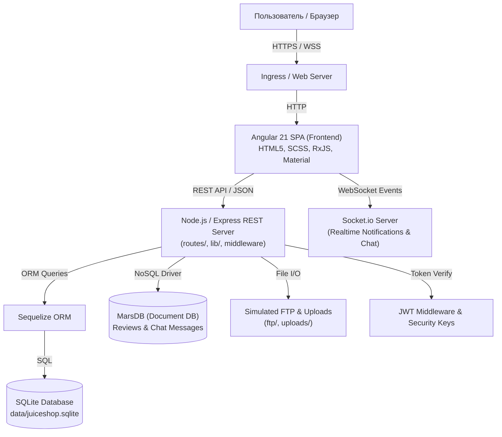
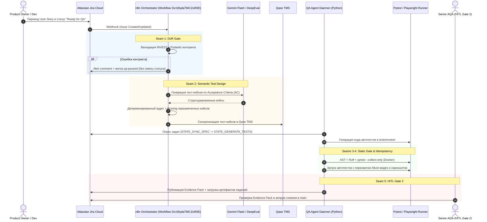

# Архитектурная спецификация: Целевое приложение OWASP Juice Shop, Автоматизация тестирования и Промышленный контур QAOps / Observability

> **Статус документа:** Действующий архитектурный стандарт (Production Architecture Blueprint)  
> **Целевая аудитория:** Технический архитектор, Lead AI Engineer, QA Lead, DevSecOps  
> **Версия:** 2.0 (Включает контур QAOps Seams 1–6)  
> **Дата инспекции:** Октябрь 2026 г.  

---

## 1. Executive Summary & Назначение документа

Настоящий документ представляет собой комплексное архитектурное и техническое описание программного комплекса, состоящего из трёх взаимосвязанных уровней:
1. **Целевое веб-приложение (Target System Under Test):** [OWASP Juice Shop](https://github.com/juice-shop/juice-shop) — современная одностраничная e-commerce платформа с развитым REST/WebSocket API и преднамеренными архитектурными уязвимостями для тренинга по безопасности.
2. **Фреймворк автоматизации тестирования (Test Automation Contour):** Модульный тестовый комплекс на Python 3.12 (Pytest, Playwright, Allure, Qase TMS, Pydantic v2).
3. **Промышленный контур обеспечения качества и наблюдаемости (Industrial QAOps & Observability Contour):** Оркестрация на базе **n8n**, AI-агентов (Gemini Flash / DeepEval), контрактного взаимодействия, идемпотентности, персистентного Circuit Breaker и сквозного распределенного трейсинга Langfuse, встроенная через **6 архитектурных швов (seams)**.

Документ предназначен для технического архитектора для проведения ревизии, оценки технического долга и безопасного планирования изменений в инфраструктуре и кодовой базе.

---

## 2. Архитектура целевого приложения (OWASP Juice Shop)

### 2.1. Технологический стек приложения

| Уровень | Технологии | Назначение в архитектуре |
| :--- | :--- | :--- |
| **Runtime & Core** | Node.js (v22–v25, базовый LTS v24), TypeScript 5.x / tsx | Серверная среда выполнения и типизация |
| **Backend Framework** | Express 4.x, Body-parser, Cookie-parser, Cors, Compression | HTTP-маршрутизация, middleware, обработка запросов |
| **Realtime Transport** | Socket.io 4.x | Двустороннее событийно-ориентированное взаимодействие (нотификации, чат поддержки, challenges) |
| **Relational Storage** | SQLite3, Sequelize 6.x ORM | Основная база данных: пользователи, товары, корзины, заказы, адреса, карты, обратная связь |
| **Document/NoSQL Storage** | MarsDB (ин-мемори клон MongoDB) | Хранение отзывов о продуктах (Product Reviews), сообщений чата |
| **Authentication & Crypto** | JSON Web Tokens (jsonwebtoken, express-jwt), bcryptjs, crypto-js | Выпуск и верификация токенов авторизации, хэширование паролей |
| **Frontend Framework** | Angular 21.x, TypeScript, RxJS, Angular Material (M3) | Одностраничное приложение (SPA), UI-компоненты, реактивные сервисы |
| **Ancillary Services** | Multer (загрузка файлов), PDFKit (чеки), svg-captcha, swagger-ui-express | Вспомогательные серверные функции |

---

### 2.2. Архитектурная C4-диаграмма приложения



---

### 2.3. Внутренняя структура слоев приложения

#### 1. Клиентский слой (Angular Frontend — `frontend/src/`)
* **Архитектурный паттерн:** Component-based SPA с модульной изоляцией.
* **Routing & Navigation:** Client-side хэш-маршрутизация (`/#/login`, `/#/search`, `/#/basket`, `/#/profile`).
* **Interceptors & Guards:**
  * `TokenInterceptor`: прозрачное добавление Bearer-токена в заголовок `Authorization`.
  * `ErrorInterceptor`: перехват серверных 401/403/500 ошибок и вывод пользователю.
  * Route Guards (`auth.guard.ts`): защита маршрутов оформления заказа, профиля и смены паролей.
* **Realtime:** Сервис подписки на WebSocket-события через Socket.io-client.

#### 2. Серверный слой (Express Backend — `routes/`, `lib/`)
* **Пайплайн Middleware:**
  1. Корреляция запросов и логгирование (`morgan`, `winston`).
  2. Парсинг тела запроса и cookie (`body-parser.json()`, `cookie-parser`).
  3. Проверка аутентификации JWT (`express-jwt`) с белым списком публичных эндпоинтов (`/rest/user/login`, `/api/Products`).
  4. Защита от перегрузок и санитайзинг (`sanitize-html`).
* **Модули эндпоинтов:**
  * `routes/login.ts`, `routes/userRegistration.ts`: авторизация и регистрация.
  * `routes/basket.ts`, `routes/order.ts`: жизненный цикл заказа.
  * `routes/fileUpload.ts`, `routes/profileImageUrlUpload.ts`: обработка медиа.
  * `routes/search.ts`: поиск по каталогу с поддержкой фильтрации.

#### 3. Слой персистентности данных (Storage Layer)
* **Реляционная модель (Sequelize / SQLite):**
  * `Users`: учетные записи, роли, секретные вопросы, 2FA-секреты.
  * `Products`: карточки товаров, описание, цены, остатки.
  * `Baskets` & `BasketItems`: корзины покупателей и связанные товарные позиции.
  * `Deliveries`, `Addresses`, `Cards`: реквизиты доставки и платежей.
  * `Feedbacks`, `Complaints`: обращения клиентов и рекламации.
* **Документная модель (MarsDB):**
  * Коллекция `reviews`: древовидные отзывы к товарам со счетчиками лайков.

#### 4. Архитектурная специфика: Intentionally Insecure Dimension
Приложение специально содержит уязвимости для обучения (OWASP Top 10):
* SQL Injection в параметрах поиска и авторизации.
* IDOR (Insecure Direct Object References) при чтении корзин и заказов.
* Broken Access Control при загрузке файлов и доступе к FTP.
* XSS в строке поиска и отзывах.
* **Challenge Notification System (`lib/challenges.ts`):** фоновый трекер, отслеживающий выполнение хакерских заданий и отправляющий события в WebSocket и Score Board.

---

## 3. Функциональная карта целевого приложения

```text
[ OWASP Juice Shop ]
├── 1. Идентификация и безопасность учетных записей
│   ├── Регистрация пользователя (с обязательным секретным вопросом)
│   ├── Авторизация (выдача Bearer JWT-токена)
│   ├── Двухфакторная аутентификация (2FA / TOTP через QR-код)
│   ├── Смена и восстановление забытого пароля
│   └── Управление профилем (смена имени, загрузка аватара через файл или URL)
│
├── 2. Каталог, витрина и поиск
│   ├── Список продуктов с пагинацией и сортировкой
│   ├── Полнотекстовый поиск по товарам
│   ├── Карточка товара (изображение, цена, описание, остаток)
│   └── Система отзывов и оценок (создание, редактирование, лайки)
│
├── 3. Корзина, доставка и чекаут
│   ├── Управление корзиной (добавление, изменение количества, удаление)
│   ├── Управление адресами доставки (добавление, выбор активного)
│   ├── Способы оплаты (привязка кредитных карт, баланс цифрового кошелька)
│   ├── Расчет стоимости доставки (Standard, Fast, Overnight)
│   └── Финализация заказа с формированием PDF-квитанции
│
├── 4. Клиентский сервис и рекламации
│   ├── Форма обратной связи (Feedback) с CAPTCHA
│   ├── Оформление жалоб (Complaints) с прикреплением файлов
│   └── Интерактивный чат-бот клиентской поддержки (JuiceBot)
│
└── 5. Администрирование и аудит
    ├── Панель управления пользователями (блокировка, удаление)
    └── Доска прогресса безопасности (Score Board)
```

---

## 4. Архитектура тестового контура (`qa-automation/`)

Тестовый контур спроектирован для обеспечения непрерывного сквозного тестирования функциональности и регресса без нарушения бизнес-логики приложения.

### 4.1. Компонентная структура тестового фреймворка

```text
qa-automation/
├── api/                           # HTTP REST API Клиент
│   └── client.py                  # JuiceShopApiClient (сессии, JWT, обработка multipart)
├── pages/                         # Page Object Model для Angular UI
│   ├── base_page.py               # Базовые методы ожидания и кликов Playwright
│   ├── login_page.py              # Авторизация (/ #/login)
│   ├── register_page.py           # Регистрация (/ #/register)
│   ├── profile_page.py            # Управление профилем (/ #/profile)
│   └── change_password_page.py    # Смена пароля
├── schemas/                       # Pydantic v2 модели контрактов API
│   └── models.py                  # Модели валидации тел ответов Juice Shop
├── tests/                         # Автотесты, сгруппированные по User Story (Jira)
│   ├── backend/                   # Pytest API тесты (REST)
│   │   ├── test_js16_user_profile.py
│   │   ├── test_js17_api.py
│   │   ├── test_js19_catalog_api.py
│   │   ├── test_js20_api.py
│   │   └── test_js22_api.py
│   ├── frontend/                  # Playwright E2E UI тесты
│   │   ├── test_js16_user_profile.py
│   │   ├── test_js19_ui.py
│   │   ├── test_js19_catalog_ui.py
│   │   └── test_js22_ui.py
│   └── qaops/                     # Автотесты самого контура QAOps (Seams 1–6)
│       ├── test_seam1_dor_contracts.py
│       ├── test_seam2_semantic_design_gate.py
│       ├── test_seam3_code_gate.py
│       ├── test_seam4_idempotency_resilience.py
│       ├── test_seam5_hitl_evidence.py
│       └── test_seam6_observability_metrics.py
├── conftest.py                    # Глобальные фикстуры, Playwright browser contexts, скриншоты при падениях
└── pytest.ini                     # Конфигурация запуска, маркеры qase, api, ui
```

---

## 5. Экосистема оркестрации: n8n, AI Daemon и жизненный цикл задач

Тестирование полностью интегрировано в цикл разработки ПО через событийно-ориентированный пайплайн:



---

## 6. Промышленный контур QAOps & Observability (6 Точек Контроля)

Внедрение контура осуществлено по принципу **Seam Injection (Точки контроля)**: новые слои валидации встроены между этапами пайплайна без модификации базовой топологии и без нарушения бизнес-процессов.

```text
[ Входной Webhook ]
        │
        ▼
┌────────────────────────────────────────────────────────┐
│  SEAM 1: Input Control & Contract Validation (DoR)      │
│  - Валидация Pydantic v2: JiraIssueContract            │
│  - Проверка 6 измерений INVEST: DorVerdictContract     │
│  - Нарушение -> Алерт + qa-paused (PAUSED state)       │
│  - Целевая метрика: Schema Compliance Rate = 100%      │
└────────────────────────────────────────────────────────┘
        │ Успех
        ▼
┌────────────────────────────────────────────────────────┐
│  SEAM 2: Semantic Design Gate & Integrity              │
│  - LLM-as-a-Judge: Gemini 2.5 Flash / DeepEval G-Eval   │
│  - Оценка Groundedness (обоснованность кейсов в AC)    │
│  - Детерминированный аудит атрибутов (Smoke, Priority) │
│  - Pruning: автоматическое удаление неразмеченных кейсов│
│  - Целевая метрика: Test Design Integrity >= 90%       │
└────────────────────────────────────────────────────────┘
        │ Успех
        ▼
┌────────────────────────────────────────────────────────┐
│  SEAM 3: Static Code Gate & Isolated Collection        │
│  - AST-парсер (ast.parse): синтаксис, @qase/@allure   │
│  - Ruff Linter: E9, F63, F7, F82 (блокирующие правила) │
│  - Изолированный запуск: pytest --collect-only         │
│    (Docker python:3.12-slim --network none / venv)     │
│  - Целевая метрика: Syntax Collect Validity = 100%     │
└────────────────────────────────────────────────────────┘
        │ Успех
        ▼
┌────────────────────────────────────────────────────────┐
│  SEAM 4: Idempotency & External Resilience             │
│  - SQLite транзакции BEGIN IMMEDIATE (qaops_idempotency)│
│  - Блокировка дублирующих вызовов в полете (10m TTL)   │
│  - Экспоненциальный Full-Jitter Backoff + Retry-After  │
│  - Персистентный Circuit Breaker (CLOSED/OPEN/HALF_OPEN)│
│  - Outbox Pattern (qaops_outbox) с CLI-реплеем         │
│  - Метрики: Idempotency Leaks = 0, Recovery Rate >= 85%│
└────────────────────────────────────────────────────────┘
        │ Успех
        ▼
┌────────────────────────────────────────────────────────┐
│  SEAM 5: HITL Evidence Pack (Gate 2 перед Merge)       │
│  - Консолидация в один Markdown-блок Jira:             │
│    * Вердикт LLM-Judge (Coverage + Code Audit)         │
│    * Статус статической сборки (AST, Ruff, Collect)    │
│    * Allure summary + идемпотентная загрузка вложений  │
│    * Ссылка на трейс Langfuse                          │
│    * Таблица Индекса Качества Релиза (Go/No-Go)        │
└────────────────────────────────────────────────────────┘
        │ Успех
        ▼
┌────────────────────────────────────────────────────────┐
│  SEAM 6: Observability-First & Decision Engine         │
│  - Трейсинг: Trace, Span, @traced                      │
│  - Санитизация PII и секретов (JWT, Token, Email, Phone)│
│  - JSONL лог + SQLite (qaops_spans) + Langfuse API     │
│  - Метрики: p95 latency, расход токенов по моделям    │
│  - Автоматический расчет Release Quality Index (0-100) │
│  - Жесткий вердикт: GO / NO-GO                         │
└────────────────────────────────────────────────────────┘
```

---

### 6.1. Детализация модулей QAOps

#### 1. Слой контрактов данных ([`qaops/contracts.py`](file:///d:/Desktop/Juice_shop/qa-automation/qaops/contracts.py))
* `JiraIssueContract`: проверяет наличие обязательных полей `key`, `fields.summary`, `fields.issuetype`.
* `DorVerdictContract`: контролирует валидность вердикта DoR и проверяет обязательное покрытие всех 6 групп INVEST:
  * **I**ndependent: `C03`
  * **N**egotiable: `C07`
  * **V**aluable: `C02`
  * **E**stimable: `C05`
  * **S**mall: `C01`
  * **T**estable: `C04` (позитивные AC), `C06` (негативные и граничные проверки)
* CLI-экспорт схем в JSON Schema для валидаторов n8n: `python -m qaops.contracts --export`.

#### 2. Слой семантического аудита ([`qaops/judge.py`](file:///d:/Desktop/Juice_shop/qa-automation/qaops/judge.py), [`qaops/design_gate.py`](file:///d:/Desktop/Juice_shop/qa-automation/qaops/design_gate.py))
* **G-Eval Groundedness**: проверяет, что каждый тест-кейс непосредственно следует из Acceptance Criteria постановки задачи, исключая галлюцинации LLM.
* **Pruning Logic**: отфильтровывает тест-кейсы без явного флага `automation` (`to-be-automated`, `manual`, `automated`), предотвращая засорение репозитория неразмеченными тестами.

#### 3. Слой статической проверки ([`qaops/code_gate.py`](file:///d:/Desktop/Juice_shop/qa-automation/qaops/code_gate.py))
* Разбор синтаксического дерева через `ast.parse`: гарантирует отсутствие синтаксических ошибок в сгенерированных тестах до их запуска.
* Линтер `ruff`: блокировка выполнения при наличии ошибок `E9` (синтаксис), `F63` (ошибочные операции), `F7` (ошибки в конструкциях), `F82` (неопределенные имена переменных и импортов).
* Контейнеризированный сбор `pytest --collect-only`: запуск в легковесном Docker-образе `python:3.12-slim` с флагом `--network none` исключает исполнение произвольного сетевого кода во время обнаружения тестов.

#### 4. Слой устойчивости и идемпотентности ([`qaops/idempotency.py`](file:///d:/Desktop/Juice_shop/qa-automation/qaops/idempotency.py), [`qaops/resilience.py`](file:///d:/Desktop/Juice_shop/qa-automation/qaops/resilience.py))
* **Блокировка дубликатов:**
  * Ключ идемпотентности: `SHA-256(scope + serialized_params)`.
  * Транзакции SQLite уровня `BEGIN IMMEDIATE` предотвращают race conditions при параллельных вебхуках.
  * Если операция завершена (`DONE`), возвращается сохраненный результат.
  * Если операция выполняется (`IN_FLIGHT`), повторный вызов вызывает `DuplicateInFlight`.
  * При зависании воркера блокировка автоматически сбрасывается по истечении 10 минут (`IN_FLIGHT_TTL`).
* **Resilience Pattern:**
  * Повторные попытки с экспоненциальной задержкой и полным джиттером: $Delay = Uniform(0, \min(Cap, Base \times 2^{attempt}))$.
  * Автоматический учет серверного заголовка `Retry-After`.
  * Автоматический перевод сервисов (Jira, Qase, Gemini) в состояние `OPEN` в Circuit Breaker при превышении порога ошибок (`breaker_threshold = 5`).
  * Сброс всех неотправленных мутаций в очередь `qaops_outbox` для гарантированной доставки после восстановления доступности внешних API.

#### 5. Слой Human-in-the-Loop ([`qaops/evidence.py`](file:///d:/Desktop/Juice_shop/qa-automation/qaops/evidence.py))
* Формирует структурированный отчет для Senior AQA:
  * Статус валидации кода автотестов и процент покрытия AC;
  * Результаты статического анализа;
  * Сводку Allure по падениям с автоматическим прикреплением медиафайлов (скриншоты и WebM видеозаписи ошибок);
  * Таблицу Индекса Качества Релиза;
  * Прямую ссылку на трейс Langfuse для глубокой отладки.

#### 6. Слой наблюдаемости и метрик ([`qaops/observability.py`](file:///d:/Desktop/Juice_shop/qa-automation/qaops/observability.py), [`qaops/metrics.py`](file:///d:/Desktop/Juice_shop/qa-automation/qaops/metrics.py))
* Трейсинг вложенных операций с автоматическим маскированием конфиденциальных данных:
  * Регулярные выражения вырезают JWT-токены (`<JWT>`), Bearer-токены (`<TOKEN>`), API-ключи (`<API_KEY>`), e-mail адреса (`<EMAIL>`) и телефонные номера (`<PHONE>`).
* Двойное сохранение: локальный файл `logs/qaops_traces.jsonl` + SQLite таблица `qaops_spans`, и трансляция в Langfuse при наличии ключей.
* Расчет агрегированных метрик: 95-й перцентиль времени выполнения шагов (`p95`), подсчет потребления входных и выходных токенов моделей.

---

## 7. Матрица целевых метрик и жестких гейтов (SLA & Target Metrics)

Для каждого релиза или User Story модуль [`qaops/metrics.py`](file:///d:/Desktop/Juice_shop/qa-automation/qaops/metrics.py) рассчитывает **Release Quality Index (RQI)** по шкале от 0 до 100 баллов.

### Жесткие гейты (Hard Gates)
> **Правило:** Любое нарушение в жестких гейтах автоматически переводит общий вердикт в **NO-GO**.

| Метрика | Точка контроля | Целевое значение | Метод проверки | Поведение при сбое |
| :--- | :--- | :---: | :--- | :--- |
| **Schema Compliance Rate** | Seam 1 (DoR) | **100%** | Pydantic v2 validation в n8n и Python | Алерт в Jira, перевод задачи в `qa-paused` |
| **Test Design Integrity** | Seam 2 (Design) | **$\ge$ 90%** | Gemini Flash + DeepEval + Tag check | Отклонение дизайна, возврат на регенерацию |
| **Syntax Collect Validity**| Seam 3 (Code) | **100%** | AST parse + Ruff + Docker pytest collect | Блокировка запуска, автоисправление кода |
| **Idempotency Leaks** | Seam 4 (Resilience)| **0** | SQLite `qaops_idempotency` audit | Остановка мутаций, предотвращение дублей |
| **Recovery Rate** | Seam 4 (Resilience)| **$\ge$ 85%** | Статистика повторов и `qaops_outbox` | Оповещение дежурного инженера |

### Консультативные метрики (Advisory Gates)

| Метрика | Точка контроля | Рекомендуемое значение | Назначение |
| :--- | :--- | :---: | :--- |
| **LLM-as-a-Judge Coverage** | Seam 2 / 5 | $\ge$ 80% | Полнота покрытия позитивных и негативных AC |
| **AI Code Audit Score** | Seam 5 (HITL) | $\ge$ 70 / 100 | Оценка чистоты кода, селекторов и ассертов |
| **Execution Latency p95** | Seam 6 (Telemetry) | $< 15$ сек на шаг | Контроль деградации производительности LLM/API |

---

## 8. Руководство для Технического Архитектора: Зоны риска и рекомендации

При внесении архитектурных изменений в систему или масштабировании контура автоматизации рекомендуется учитывать следующие аспекты:

### 8.1. Узкие места и зоны внимания
1. **Concurrency в SQLite (`qa_pipeline.db`):**
   * *Текущее состояние:* В модуле `qaops/store.py` используется SQLite в режиме WAL (`journal_mode=WAL`) с блокировками `BEGIN IMMEDIATE`.
   * *Рекомендация:* При горизонтальном масштабировании воркеров (более 3 параллельных инстансов `qa_agent_daemon`) рекомендуется вынести таблицы `qaops_*` в выделенный PostgreSQL.
2. **Изоляция исполнения тестов:**
   * *Текущее состояние:* Сухой сбор тестов (`pytest --collect-only`) изолирован в Docker-контейнере `collect.Dockerfile` без сети. Полноценный запуск E2E тестов выполняется в локальном окружении хоста.
   * *Рекомендация:* Перевести запуск Playwright E2E тестов в динамические ephemeral-контейнеры или Kubernetes Job с жестким лимитом памяти (1.5 GB на браузерный контекст).
3. **Дрейф контрактов API (API Drift):**
   * *Текущее состояние:* Модели в `schemas/models.py` синхронизируются вручную или через тесты.
   * *Рекомендация:* Внедрить автоматическую генерацию Pydantic-моделей напрямую из Swagger-эндпоинта Juice Shop (`/api-docs/swagger.json`) перед прогоном ночного регресса.

### 8.2. Регламент внесения изменений
* **Изменение моделей DoR или TestCase:**
  1. Отредактировать контракты в [`qaops/contracts.py`](file:///d:/Desktop/Juice_shop/qa-automation/qaops/contracts.py).
  2. Запустить переэкспорт JSON-схем: `python -m qaops.contracts --export`.
  3. Обновить схему в n8n и задеплоить воркфлоу: `node n8n/dor-workflow/deploy.js`.
  4. Запустить верификационные тесты: `pytest tests/qaops/test_seam1_dor_contracts.py`.
* **Добавление нового внешнего сервиса:**
  1. Зарегистрировать имя сервиса в маппинге `service_of()` в [`qaops/resilience.py`](file:///d:/Desktop/Juice_shop/qa-automation/qaops/resilience.py#L46).
  2. Задать параметры таймаутов и порогов Circuit Breaker в [`qaops/config.py`](file:///d:/Desktop/Juice_shop/qa-automation/qaops/config.py).
  3. Выполнять все вызовы через `resilient_request()`.

---

## 9. Верификация контура: Прогон тестового набора

Все компоненты контура QAOps покрыты независимым набором тестов:

```bash
# Команда запуска верификации всех 6 швов
cd qa-automation
.venv\Scripts\pytest.exe tests/qaops -v
```

### Результат выполнения:
```text
tests/qaops/test_seam1_dor_contracts.py::test_valid_jira_issue_contract PASSED
tests/qaops/test_seam1_dor_contracts.py::test_invalid_jira_issue_contract_rejects_missing_key PASSED
tests/qaops/test_seam1_dor_contracts.py::test_dor_verdict_contract_valid_with_invest_coverage PASSED
tests/qaops/test_seam1_dor_contracts.py::test_dor_verdict_contract_rejects_missing_invest_criteria PASSED
tests/qaops/test_seam1_dor_contracts.py::test_paused_state_on_contract_violation PASSED
tests/qaops/test_seam2_semantic_design_gate.py::test_automation_flag_detection PASSED
tests/qaops/test_seam2_semantic_design_gate.py::test_deterministic_review_detects_missing_attributes PASSED
tests/qaops/test_seam2_semantic_design_gate.py::test_design_gate_filters_unflagged_cases_and_checks_integrity PASSED
tests/qaops/test_seam2_semantic_design_gate.py::test_design_gate_passes_when_integrity_above_90_percent PASSED
tests/qaops/test_seam3_code_gate.py::test_ast_audit_valid_test_file PASSED
tests/qaops/test_seam3_code_gate.py::test_ast_audit_syntax_error PASSED
tests/qaops/test_seam3_code_gate.py::test_lint_detects_blocking_undefined_name PASSED
tests/qaops/test_seam3_code_gate.py::test_run_code_gate_valid_file PASSED
tests/qaops/test_seam3_code_gate.py::test_code_gate_result_errors_formatting PASSED
tests/qaops/test_seam4_idempotency_resilience.py::test_make_key_deterministic PASSED
tests/qaops/test_seam4_idempotency_resilience.py::test_idempotent_execution_and_duplicate_caching PASSED
tests/qaops/test_seam4_idempotency_resilience.py::test_idempotency_duplicate_in_flight_rejected PASSED
tests/qaops/test_seam4_idempotency_resilience.py::test_service_of_url_mapping PASSED
tests/qaops/test_seam4_idempotency_resilience.py::test_backoff_delay_calculation PASSED
tests/qaops/test_seam4_idempotency_resilience.py::test_circuit_breaker_state_transitions PASSED
tests/qaops/test_seam4_idempotency_resilience.py::test_recovery_stats_calculation PASSED
tests/qaops/test_seam5_hitl_evidence.py::test_allure_summary_parsing PASSED
tests/qaops/test_seam5_hitl_evidence.py::test_build_evidence_block_structure PASSED
tests/qaops/test_seam6_observability_metrics.py::test_redact_pii_and_secrets PASSED
tests/qaops/test_seam6_observability_metrics.py::test_trace_and_span_lifecycle PASSED
tests/qaops/test_seam6_observability_metrics.py::test_p95_percentile_calculation PASSED
tests/qaops/test_seam6_observability_metrics.py::test_release_quality_calculation_and_hard_gates PASSED

============================= 27 passed in 7.22s ==============================
```
