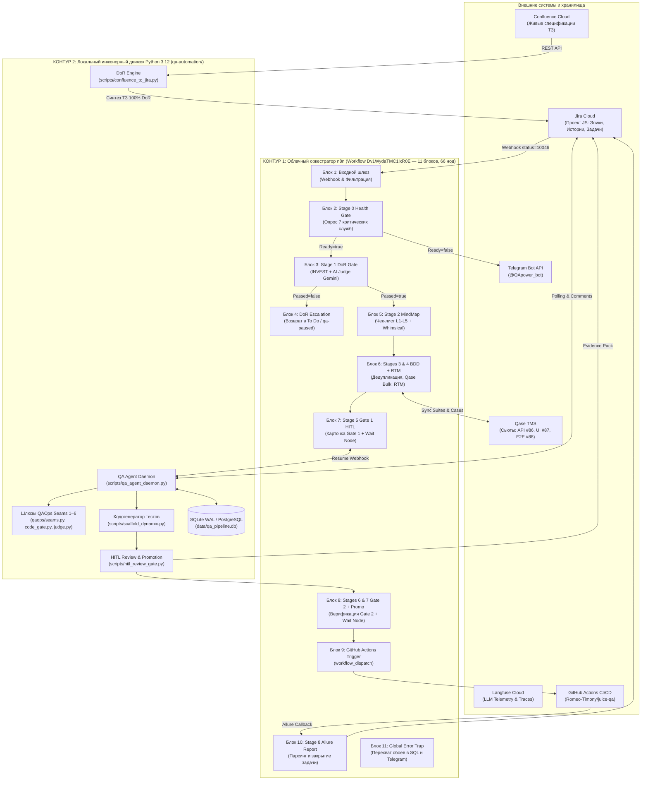

# Генеральная спецификация продукта (Master SDD Blueprint)
## Autonomous Enterprise QAOps & Self-Healing Testing Platform

> Методология разработки: Specification-Driven Development (SDD) + Test-Driven Development (TDD)  
> Версия спецификации: 3.0 (Full Node-Level & Engine-Level SDD Standard)  
> Объект спецификации: Собственный программный продукт - двухконтурная платформа автоматизации обеспечения качества (Контур 1: Оркестратор n8n `Dv1WydaTMC1lxR0E` + Контур 2: Инженерный движок Python `qa_agent_daemon.py` & `qaops/`).  
> Тестируемый стенд (SUT): OWASP Juice Shop v20.2.0 (`http://localhost:3000`).

---

## 1. Философия SDD + TDD в архитектуре продукта

### 1.1. Разделение Продукта и Целевого стенда (SUT)
1. Наш продукт (Система): платформа оркестрации и кодогенерации QAOps, состоящая из 66 функциональных нод (в 11 логических блоках) в n8n и локального демона/движка на Python 3.12 (`scripts/`, `qaops/`).
2. Целевой объект тестирования (SUT): интернет-магазин OWASP Juice Shop, на котором наш продукт демонстрирует полный цикл от анализа ТЗ в Confluence/Jira до прогона автотестов в CI/CD.
3. Почему мы НЕ пишем тесты на автотесты: тестировать сгенерированные тестовые сценарии (`test_js40_api.py`, `test_js41_ui.py`) другими тестами - антипаттерн. Сгенерированные автотесты верифицируются статическим гейтом (Seam 3: AST, Ruff, `pytest --collect-only`) и реальным прогоном против SUT.
4. К чему применяется связка SDD + TDD:
   - SDD (Specification-Driven Development): ни одна нода n8n и ни один модуль Python-демона не изменяются по устной договорённости. Каждая нода и каждый модуль имеют формализованный Инженерный Паспорт (Node/Module Contract) в настоящем документе: входной JSON-контракт, бизнес-правило, выходной JSON-контракт и поведение при сбое.
   - TDD (Test-Driven Development - `Spec -> Red -> Green -> Refactor`): перед изменением логики любой ноды n8n или модуля Python-движка сначала пишется модульный/контрактный тест в `tests/qaops/test_sdd_node_and_engine_contracts.py` или `tests/unit/`, который проверяет соблюдение контракта спецификации. Сначала фиксируется падение теста (`Red`), затем пишется код ноды/модуля до прохождения теста (`Green`), и проводится рефакторинг (`Refactor`).

---

## 2. Системная архитектура и схема взаимодействия контуров



---

## 3. По-нодовая спецификация Контура 1 (n8n Workflow `Dv1WydaTMC1lxR0E`)

Воркфлоу состоит из 77 узлов: 11 цветных стикеров-контейнеров (документация на холсте) и 66 функциональных нод, сгруппированных в 11 архитектурных блоков.

---

### БЛОК 1: Входной шлюз задач (Ingestion & Event Filtering)
Граница ответственности: Приём событий от Jira Cloud (или прямого вызова оркестратора), проверка подлинности токена, фильтрация перехода в статус В работе (`ID: 10046`) и нормализация контекста задачи.

#### Паспорт ноды `N01` (`Jira: Перехват обновления задачи`)
- Код требования: `REQ-N8N-01`
- Тип ноды: `n8n-nodes-base.webhook`
- Координаты: `[-288, 384]`
- HTTP-контракт: `POST /webhook/jira-dor-gate`
- Входной контракт (`Input Payload`):
  1. Нативный Jira Webhook (`{ webhookEvent: "jira:issue_updated", issue: { key, id, fields }, changelog: { items: [...] } }`), либо
  2. Прямой JSON-триггер оркестратора (`{ issueKey: "JS-XX", actor: "..." }`).
- Выходной контракт (`Output Payload`): Передаёт сырой HTTP-запрос (`headers`, `query`, `body`) в ноду `Фильтр: Задача взята в работу`.
- Обработка ошибок: При некорректном методе (не `POST`) возвращает `HTTP 404/405`.

#### Паспорт ноды `N02` (`Execute Workflow Trigger`)
- Код требования: `REQ-N8N-02`
- Тип ноды: `n8n-nodes-base.executeWorkflowTrigger`
- Координаты: `[-288, 592]`
- Назначение: Входная точка для вызова воркфлоу как дочернего процесса из других воркфлоу n8n или ручного тестирования.
- Выходной контракт: Передаёт входной JSON в `Фильтр: Задача взята в работу`.

#### Паспорт ноды `N03` (`Фильтр: Задача взята в работу`)
- Код требования: `REQ-N8N-03`
- Тип ноды: `n8n-nodes-base.code` (JavaScript)
- Координаты: `[0, 384]`
- Файл исходного кода: [`n8n/dor-workflow/nodes/01_filter_event.js`](../n8n/dor-workflow/nodes/01_filter_event.js)
- Входной контракт: Любой из 4 форматов:
  - `Case A (Polling):` `{ issues: [{ key, id, fields }] }`
  - `Case B (Jira Webhook):` `{ query: { token }, body: { webhookEvent: "jira:issue_updated", issue: { key, id }, changelog: { items: [{ field: "status", to: "10046" }] } } }`
  - `Case C (Direct Trigger):` `{ issueKey: "JS-XX", actor: "..." }`
  - `Case D (Manual Empty Click):` `{}`
- Бизнес-правила:
  1. Для `Case B` проверяется совпадение `query.token === CONFIG.webhookToken`, префикс проекта `JS-` и наличие перехода поля `status` в `10046` (`В работе` / `In Progress`).
  2. Если условие не выполнено - возвращается пустой массив `[]` (выполнение цепочки штатно прекращается без ошибки).
- Выходной контракт (`Output Payload`):
  ```json
  {
    "issueKey": "JS-40",
    "issueId": "10040",
    "fromStatus": "К выполнению",
    "toStatus": "В работе",
    "actor": "Roman Timoshenko",
    "receivedAt": "2026-11-09T08:00:00.000Z",
    "config": {
      "jiraBase": "https://romeo-timony.atlassian.net",
      "projectKey": "JS",
      "inProgressStatusId": "10046",
      "todoStatusId": "10045",
      "geminiModel": "gemini-3.5-flash"
    }
  }
  ```

---

### БЛОК 2: Предстартовая диагностика всех 7 сервисов (Stage 0 Pre-Flight Health Gate)
Граница ответственности: Последовательный опрос 7 внешних и внутренних зависимостей перед запуском анализа задачи. Блокирует старт при недоступности любого критического сервиса.

| Код ноды | Имя ноды в n8n | Тип | Целевой URL / Проба | Критерий готовности (`PASS`) |
| :--- | :--- | :--- | :--- | :--- |
| `N04` | `Stage 0: Проверка Jira Cloud API` | `httpRequest` | `GET {{ jiraBase }}/rest/api/2/myself` | Наличие `accountId` или `emailAddress` |
| `N05` | `Stage 0: Проверка Qase TMS API` | `httpRequest` | `GET https://api.qase.io/v1/project/JS` | `status === true` и `result.code === "JS"` |
| `N06` | `Stage 0: Проверка Telegram Bot (@QApower_bot)` | `httpRequest` | `GET https://api.telegram.org/bot<TOKEN>/getMe` | `ok === true` и `result.username` задан |
| `N07` | `Stage 0: Проверка Langfuse Observability` | `httpRequest` | `GET https://cloud.langfuse.com/api/public/health` | `status === "OK"` |
| `N08` | `Stage 0: Проверка Google Gemini LLM` | `httpRequest` | `GET .../v1beta/models/gemini-flash-lite-latest` | Наличие поля `name` с `models/gemini` |
| `N09` | `Stage 0: Проверка GitHub Actions CI/CD` | `httpRequest` | `GET https://api.github.com/repos/Romeo-Timony/juice-qa` | Наличие `id` или `full_name` репозитория |
| `N10` | `Stage 0: Проверка SQL Базы и Data Tables` | `httpRequest` | `GET http://201.34.147.33:5678/api/v1/data-tables` | Непустой массив `data` (`length > 0`) |

(Во всех нодах `N04..N10` включён флаг `onError: continueRegularOutput`, чтобы сбой отдельной пробы не обрывал воркфлоу, а передавался в агрегатор `N11`).

#### Паспорт ноды `N11` (`Stage 0: Валидация готовности ВСЕЙ инфраструктуры`)
- Код требования: `REQ-N8N-11`
- Тип ноды: `n8n-nodes-base.code`
- Координаты: `[1184, 592]`
- Входной контракт: Ответы всех 7 проб `N04..N10` и контекст `N03`.
- Алгоритм: Проверяет булевы флаги готовности всех 7 служб, формирует массив `failedServices` и текстовую сводку `summaryText`.
- Выходной контракт (`Output Payload`):
  ```json
  {
    "issueKey": "JS-40",
    "preFlight": {
      "isReady": true,
      "totalChecked": 7,
      "passedCount": 7,
      "failedCount": 0,
      "failedServices": [],
      "summaryText": "..."
    }
  }
  ```

#### Паспорт ноды `N12` (`Условие: Все службы и агенты готовы к работе?`)
- Код требования: `REQ-N8N-12`
- Тип ноды: `n8n-nodes-base.if`
- Условие: `$json.preFlight.isReady === true` (strict boolean).
- Маршрутизация:
  - Ветка `true (main:0)` -> `N14 (Jira: Загрузить данные задачи)`.
  - Ветка `false (main:1)` -> `N13 (Telegram: Отказ запуска — сбой инфраструктуры)`.

#### Паспорт ноды `N13` (`Telegram: Отказ запуска — сбой инфраструктуры`)
- Код требования: `REQ-N8N-13`
- Тип ноды: `n8n-nodes-base.telegram`
- Назначение: Отправляет HTML-карточку в чат `1434200911` со списком упавших сервисов `preFlight.summaryText` и блокирует дальнейшее выполнение.

---

### БЛОК 3: Этап 1 - Проверка готовности требований к тестированию (DoR Gate)
Граница ответственности: Загрузка полных данных тикета и внешних ссылок из Jira, оценка качества ТЗ по эталону QA DoR v1.0 (10 общих + профильные критерии API/UI/Story + 6 измерений INVEST) и независимый аудит моделью Google Gemini.

#### Паспорт ноды `N14` (`Jira: Загрузить данные задачи`)
- Код требования: `REQ-N8N-14`
- Тип ноды: `n8n-nodes-base.httpRequest`
- HTTP-контракт: `GET {{ config.jiraBase }}/rest/api/2/issue/{{ issueKey }}?fields=summary,description,issuetype,parent,labels,priority,issuelinks,subtasks,reporter,assignee,status,comment`
- Выходной контракт: Полный JSON-объект задачи Jira (`id`, `key`, `fields`).

#### Паспорт ноды `N15` (`Jira: Загрузить ссылки задачи`)
- Код требования: `REQ-N8N-15`
- Тип ноды: `n8n-nodes-base.httpRequest`
- HTTP-контракт: `GET {{ config.jiraBase }}/rest/api/2/issue/{{ issueKey }}/remotelink`
- Выходной контракт: Массив внешних ссылок задачи (Confluence, Qase, Design).

#### Паспорт ноды `N16` (`Правила проверки готовности задачи`)
- Код требования: `REQ-N8N-16`
- Тип ноды: `n8n-nodes-base.code`
- Файл исходного кода: [`n8n/dor-workflow/nodes/02_dor_standard.js`](../n8n/dor-workflow/nodes/02_dor_standard.js)
- Выходной контракт: Объект `{ standard }` с параметрами `version: "1.0"`, `passingScore: 80`, базовыми критериями `C01..C10`, профильными критериями `backend`, `frontend`, `story` и стоп-словами `vagueWords`.

#### Паспорт ноды `N17` (`Подготовка задачи к проверке`)
- Код требования: `REQ-N8N-17`
- Тип ноды: `n8n-nodes-base.code`
- Файл исходного кода: [`n8n/dor-workflow/nodes/03_build_validation_prompt.js`](../n8n/dor-workflow/nodes/03_build_validation_prompt.js)
- Алгоритм:
  1. Конвертирует описание Jira (ADF или Wiki-разметку) в чистый текст.
  2. Классифицирует профиль задачи `kind`:
     - `e2e`: если в заголовке есть `[e2e]`, `end-to-end`, `journey`, `онбординг`;
     - `frontend`: если `[ui]`, `[front]`, `angular`, `страниц`, `форм`;
     - `backend`: если `[api]`, `[back]`, `rest`, `endpoint`, `sql`;
     - `story` / `task`: по типу задачи Jira.
  3. Выполняет детерминированные предпроверки `autoChecks` (длина описания, наличие ссылок на Confluence, наличие AC, отсутствие размытых формулировок).
- Выходной контракт: `{ issueKey, kind, summary, description, criteria, autoChecks, context }`.

#### Паспорты нод `N18` (`LLM Judge: Оценка готовности (DoR Gate)`) и `N19` (`Gemini Model: DoR Judge`)
- Код требования: `REQ-N8N-18`, `REQ-N8N-19`
- Типы нод: `@n8n/n8n-nodes-langchain.chainLlm` + `@n8n/n8n-nodes-langchain.lmChatGoogleGemini` (`gemini-flash-lite-latest`, `temperature: 0.1`).
- Входной контракт: Контекст задачи (`issueKey`, `kind`, `summary`, `description`, `autoChecks`).
- Выходной контракт: Строгий JSON `{ aiScore: 0..100, aiVerdict: "PASS"|"FAIL", investBreakdown: {...}, risks: [...], summary: "..." }`.

#### Паспорт ноды `N20` (`Проверка задачи на готовность`)
- Код требования: `REQ-N8N-20`
- Тип ноды: `n8n-nodes-base.code`
- Файл исходного кода: [`n8n/dor-workflow/nodes/04_evaluate_verdict.js`](../n8n/dor-workflow/nodes/04_evaluate_verdict.js)
- Алгоритм:
  1. Валидирует входной контракт `JiraIssueContract` и 6 измерений INVEST (`DorVerdictContract`).
  2. Оценивает каждый критерий `C01..C10` + профильные критерии (`pass` = 1.0, `partial` = 0.5, `fail` = 0.0).
  3. Интегрирует оценку LLM-судьи `N18`.
  4. Определяет `passed = (contractValid && mandatoryFailures.length === 0 && score >= 80)`.
  5. Проверяет наличие существующего комментария `[Этап 1 из` в тикете для идемпотентного обновления (`PUT` вместо дублирующего `POST`).
- Выходной контракт: `{ issueKey, passed, score, contractValid, targetLabel, commentMethod, commentUrl, commentBody, results }`.

#### Паспорт ноды `N21` (`Условие: Требования задачи понятны?`)
- Код требования: `REQ-N8N-21`
- Тип ноды: `n8n-nodes-base.if`
- Условие: `$json.passed === true`.
- Маршрутизация:
  - `true (main:0)` -> `N22 (Jira: Отчет 1 — Задача готова к работе (DoR Gate))`
  - `false (main:1)` -> Блок 4 (`N24: Jira: Отправить замечания к задаче`).

#### Паспорты нод `N22` (`Jira: Отчет 1 — Задача готова к работе`) и `N23` (`Langfuse: Фиксация трейса и метрик`)
- Код требования: `REQ-N8N-22`, `REQ-N8N-23`
- Назначение:
  - `N22` публикует (`POST`/`PUT`) комментарий `[Этап 1 из 8] Проверка готовности требований (DoR Gate)` в Jira.
  - `N23` параллельно отправляет распределённый трейс `qa-dor-and-design-gate` в `https://cloud.langfuse.com/api/public/ingestion`.

---

### БЛОК 4: Возврат задачи аналитику при неполных требованиях (DoR Escalation)
Граница ответственности: Обработка отказа DoR (`passed === false`): публикация замечаний, постановка на паузу при нарушении контракта (`qa-paused`) либо возврат задачи в статус К выполнению (`transition 11`, метка `qa-dor-failed`) и алерт в Telegram.

| Код ноды | Имя ноды в n8n | Тип | Действие и контракт |
| :--- | :--- | :--- | :--- |
| `N24` | `Jira: Отправить замечания к задаче` | `httpRequest` | `POST/PUT {{ commentUrl }}` с карточкой отказа и списком блокеров |
| `N25` | `Условие: Пауза из-за контракта или возврат?` | `if` | Проверяет `targetLabel === "qa-paused"` |
| `N26` | `Jira: Поставить метку qa-paused` | `httpRequest` | Ветка `true`: `PUT /rest/api/2/issue/{{ issueKey }}` (`add: "qa-paused"`) |
| `N27` | `Jira: Вернуть задачу на доработку` | `httpRequest` | Ветка `false`: `POST /rest/api/2/issue/{{ issueKey }}/transitions` (`id: "11"`) |
| `N28` | `Jira: Поставить метку Требует доработки` | `httpRequest` | `PUT /rest/api/2/issue/{{ issueKey }}` (`add: "qa-dor-failed"`) |
| `N29` | `Telegram: Алерт об отклонении DoR` | `telegram` | Отправляет алерт с динамическим `{{ issueKey }}` и ссылкой на задачу |

---

### БЛОК 5: Этап 2 - Интеллект-карта и декомпозиция проверок (QA MindMap)
Граница ответственности: Генерация 5-уровневой иерархической карты тест-дизайна (`L1..L5`) с классами эквивалентности, граничными значениями (BVA) и проверками OWASP Top 10, плюс готовый Markdown-блок для импорта в Whimsical.

#### Паспорт ноды `N30` (`Подготовка данных для чек-листа`)
- Код требования: `REQ-N8N-30`
- Тип ноды: `n8n-nodes-base.code`
- Файл исходного кода: [`n8n/dor-workflow/nodes/05_build_checklist_prompt.js`](../n8n/dor-workflow/nodes/05_build_checklist_prompt.js)
- Выходной контракт: `{ issueKey, kind, summary, description, existingCommentId }`.

#### Паспорт ноды `N31` (`Создание карты проверок`)
- Код требования: `REQ-N8N-31`
- Тип ноды: `n8n-nodes-base.code`
- Файл исходного кода: [`n8n/dor-workflow/nodes/06_format_checklist.js`](../n8n/dor-workflow/nodes/06_format_checklist.js)
- Алгоритм: Строит глубокий чек-лист `L1..L5` строго по профилю задачи (`backend`, `frontend`, `e2e`) и блок `{code:markdown}` для Whimsical Mind Maps. Определяет `commentMethod` (`PUT`/`POST`) и `commentUrl` по наличию `[Этап 2 из`.
- Выходной контракт: `{ issueKey, kind, commentMethod, commentUrl, commentBody }`.

#### Паспорт ноды `N32` (`Whimsical: Генерация MindMap`)
- Код требования: `REQ-N8N-32`
- Тип ноды: `n8n-nodes-base.code`
- Алгоритм: Обогащает выход `N31` метаданными `whimsicalUrl` и `mindmapId`, сохраняя `commentMethod`, `commentUrl`, `commentBody`.

#### Паспорт ноды `N33` (`Jira: Отчет 2 — Интеллект-карта проверок`)
- Код требования: `REQ-N8N-33`
- Тип ноды: `n8n-nodes-base.httpRequest`
- HTTP-контракт: `{{ $json.commentMethod }} {{ $json.commentUrl }}` с телом `{ body: $json.commentBody }`.

---

### БЛОК 6: Этапы 3 и 4 - Синхронизация с Qase TMS, BDD тест-дизайн и матрица RTM
Граница ответственности: Загрузка папок и существующих кейсов из Qase TMS, дедупликация, создание недостающих кейсов в соответствующем архитектурном сьюте (`API`, `UI`, `E2E`), получение реальных ID созданных кейсов (`JS-XXX`), семантический аудит LLM-судьёй и публикация Отчета №3 (Реестр BDD) и Отчета №4 (Матрица RTM) со 100% рабочими ссылками на кейсы в Qase.

#### Паспорт ноды `N34` (`Подготовка данных для тест-кейсов`)
- Код требования: `REQ-N8N-34`
- Тип ноды: `n8n-nodes-base.code`
- Файл исходного кода: [`n8n/dor-workflow/nodes/07_build_testcases_prompt.js`](../n8n/dor-workflow/nodes/07_build_testcases_prompt.js)
- Выходной контракт: `{ issueKey, kind, prefix, summary, description }`.

#### Паспорты нод `N35` (`Qase: Загрузить список папок`) и `N36` (`Qase: Загрузить существующие тесты`)
- Код требования: `REQ-N8N-35`, `REQ-N8N-36`
- Тип нод: `n8n-nodes-base.httpRequest`
- HTTP-контракты:
  - `N35`: `GET https://api.qase.io/v1/suite/JS?limit=100`
  - `N36`: `GET https://api.qase.io/v1/case/JS?limit=100`

#### Паспорт ноды `N37` (`Создание тест-кейсов без повторов`)
- Код требования: `REQ-N8N-37`
- Тип ноды: `n8n-nodes-base.code`
- Файл исходного кода: [`n8n/dor-workflow/nodes/08_format_testcases.js`](../n8n/dor-workflow/nodes/08_format_testcases.js)
- Алгоритм и SDD-инварианты:
  1. Определяет целевой корневой сьют Qase TMS: `API` (для `backend`), `UI` (для `frontend`), `E2E` (для `e2e`/`story`).
  2. Строит карту существующих кейсов `existingTitleMap` (`title.toLowerCase() -> id`).
  3. Проверяет каждый сгенерированный кейс по правилам Seam 2 (наличие флага `automation`, `priority`, тегов `fast-regression`/`full-regression`).
  4. Если в `qaseCases` есть новые кейсы, отсутствующие в `existingTitleMap`, выполняет синхронный `POST https://api.qase.io/v1/case/JS/bulk` через `qasePost`, получает массив реальных созданных ID (`r.result.ids`) и записывает их в `existingTitleMap` ДО формирования таблиц Отчета №3 и Отчета №4.
  5. Формирует `casesReport` (`[Этап 3 из 8] Реестр тест-кейсов (BDD)`) и `rtmCommentBody` (`[Этап 4 из 8] Матрица трассируемости требований (RTM)`), подставляя в каждую строку реальные кликабельные ссылки `[JS-${id}|https://app.qase.io/case/JS-${id}]`.
  6. Не содержит мёртвых дублирующихся веток `else if (kind === 'e2e')`.
- Выходной контракт:
  ```json
  {
    "issueKey": "JS-40",
    "kind": "backend",
    "cases": [...],
    "qaseCases": [],
    "hasNewCases": false,
    "testDesignIntegrity": 1.0,
    "designGatePassed": true,
    "casesReport": "h2. 🧪 [Этап 3 из 8] ...",
    "rtmCommentBody": "h2. 📊 [Этап 4 из 8] ...",
    "casesMethod": "POST",
    "casesUrl": "...",
    "rtmMethod": "POST",
    "rtmUrl": "..."
  }
  ```

#### Паспорты нод `N38` (`LLM Judge: Аудит тест-дизайна`) и `N39` (`Gemini Model: Design Gate Judge`)
- Код требования: `REQ-N8N-38`, `REQ-N8N-39`
- Типы нод: `@n8n/n8n-nodes-langchain.chainLlm` + `lmChatGoogleGemini`
- Назначение: Независимый семантический аудит полноты покрытия AC, BVA и отсутствия галлюцинаций в сгенерированных тест-кейсах.

#### Паспорты нод `N40` (`Jira: Отчет 3 — Реестр тест-кейсов (BDD)`) и `N41` (`Jira: Отчет 4 — Матрица трассируемости (RTM)`)
- Код требования: `REQ-N8N-40`, `REQ-N8N-41`
- Тип нод: `n8n-nodes-base.httpRequest`
- Назначение: Публикация (`POST`/`PUT`) Отчета №3 и Отчета №4 в тикет Jira.

#### Паспорты нод `N42` (`Условие: Есть новые тесты?`), `N43` (`Qase: Создать новые тесты в базе`), `N44` (`Jira: Прикрепить ссылку на тесты в Qase`)
- Код требования: `REQ-N8N-42` .. `REQ-N8N-44`
- Назначение: Резервный bulk-запрос в Qase (если `hasNewCases === true`) и прикрепление Remote Link на проект `https://app.qase.io/project/JS` в тикет Jira (`globalId: "qase-project-JS-" + issueKey`).

#### Паспорты нод `N45` (`Анализ рассинхрона Qase (Drift Detector)`), `N46` (`Telegram: Алерт о рассинхронизации Qase`), `N47` (`Jira: Регистрация дрифта в задаче`)
- Код требования: `REQ-N8N-45` .. `REQ-N8N-47`
- SDD-инварианты:
  1. Нода `N45` динамически берет `issueKey` из `$('Фильтр: Задача взята в работу').item.json.issueKey`.
  2. В штатном режиме (`isDrift === false`) поток идёт только в `N48 (Контроль 1: Подтверждение тест-кейсов)`. Ноды `N46` и `N47` вызываются исключительно при реальном обнаружении дрифта, а URL в `N47` использует динамический `{{ issueKey }}` (без хардкода `JS-40`).

---

### БЛОК 7: Этап 5 - Первое согласование инженером (Quality Gate 1 - HITL)
Граница ответственности: Формирование карточки Gate 1 в Jira с маркером `[N8N_EXECUTION_ID: {{ $execution.id }}]`, отправка уведомления лиду в Telegram и постановка воркфлоу на паузу (`Wait Node`) до получения ответа `ОК` в Jira.

| Код ноды | Имя ноды в n8n | Тип | Контракт и поведение |
| :--- | :--- | :--- | :--- |
| `N48` | `Контроль 1: Подтверждение тест-кейсов` | `code` | Формирует тело `[Этап 5 из 8] Контроль 1` с `[N8N_EXECUTION_ID: {{ $execution.id }}]` и считает метрики набора (`totalCases`, `autoCount`, `manualCount`) |
| `N49` | `Jira: Карточка подтверждения тестов (Gate 1)` | `httpRequest` | `POST/PUT {{ gate1Url }}` - публикует карточку ожидания Gate 1 в Jira |
| `N50` | `Telegram: Оповещение об успешном DoR` | `telegram` | Отправляет уведомление о готовности тест-дизайна к согласованию Gate 1 |
| `N51` | `Ожидание согласования тест-дизайна (Gate 1 Wait)` | `wait` | `resume: "webhook"` (`GET/POST`). Ждёт сигнала возобновления от `qa_agent_daemon.py` после ответа `ОК` в Jira |

---

### БЛОК 8: Этапы 6 и 7 - Контроль кода автотестов (Gate 2) и Внедрение в проект
Граница ответственности: Координация с локальным демоном (`Контур 2`), который при согласовании Gate 1 генерирует тесты в `tests/review/`, проводит статический и AI-аудит (Seam 3 & Seam 5) и публикует богатый Evidence Pack (`[Этап 6 из 8]`). После второго ответа `ОК` в Jira демон промоутирует файлы в `tests/backend/` или `tests/frontend/`, публикует `[Этап 7 из 8]` и будит `Gate 2 Wait`.

| Код ноды | Имя ноды в n8n | Тип | SDD-контракт (Исключение дублирования с Контуром 2) |
| :--- | :--- | :--- | :--- |
| `N52` | `Jira: Карточка проверки кода (Gate 2)` | `httpRequest` | Выполняет `GET {{ jiraBase }}/rest/api/2/issue/{{ issueKey }}/comment` для верификации опубликованного демоном Evidence Pack `[Этап 6 из 8]` (не затирая его и не создавая дубль) |
| `N53` | `Telegram: Запрос согласования кода (Gate 2)` | `telegram` | Отправляет карточку Gate 2 в Telegram с динамическим суффиксом файла (`_api.py` для API, `_ui.py` для UI/E2E) |
| `N54` | `Ожидание согласования кода (Gate 2 Wait)` | `wait` | `resume: "webhook"` (`GET/POST`). Ждёт сигнала от `qa_agent_daemon.py` после аппрува `ОК` на Gate 2 |
| `N55` | `Jira: Отчет 7 — Внедрение автотестов в проект` | `httpRequest` | Выполняет `GET {{ jiraBase }}/rest/api/2/issue/{{ issueKey }}/comment` для верификации опубликованного демоном отчёта `[Этап 7 из 8]` (без создания дубликата) |

---

### БЛОК 9: Запуск автоматических тестов в конвейере GitHub Actions CI/CD
Граница ответственности: Вызов раннера GitHub Actions для репозитория `Romeo-Timony/juice-qa` и оповещение команды в Telegram.

- `N56` (`GitHub: Запуск автотестов в CI/CD`): `n8n-nodes-base.github` (`workflow_dispatch` для `Romeo-Timony/juice-qa`, `qa_tests.yml`).
- `N57` (`Telegram: Оповещение о старте CI/CD`): `n8n-nodes-base.telegram` - пуш-уведомление с динамическим `{{ issueKey }}` и веткой `qa/{{ issueKey.toLowerCase() }}`.

---

### БЛОК 10: Этап 8 - Результаты прогона автотестов и отчётность Allure Report
Граница ответственности: Приём результатов прогона из CI/CD (или локального раннера), публикация финального Отчета №8 в Jira и итогового уведомления в Telegram.

- `N58` (`Ожидание завершения CI/CD и отчета Allure`): `n8n-nodes-base.wait` (`resume: "webhook"`).
- `N59` (`Webhook: Прием отчетов GitHub Actions`): `POST /webhook/github-actions-report`.
- `N60` (`Парсинг отчета Allure`): `n8n-nodes-base.set` - извлекает `issueKey`, `status`, `runUrl`, `allureSummary`.
- `N61` (`Jira: Опубликовать отчет Allure`): `POST /rest/api/2/issue/{{ issueKey }}/comment` с телом `[Этап 8 из 8]`.
- `N62` (`Telegram: Отчет Allure из CI/CD`): финальное оповещение в Telegram с динамическим `{{ issueKey }}`.

---

### БЛОК 11: Глобальный перехватчик системных сбоев (Global Error Trap)
Граница ответственности: Автоматический перехват необработанных исключений любой ноды воркфлоу, запись инцидента в таблицу `QA Pipeline Errors` (`eCPXK5QUBpIxYyEc`) и экстренный алерт в Telegram.

- `N63` (`Error Trigger: Перехват системных сбоев`): `n8n-nodes-base.errorTrigger`.
- `N64` (`Форматирование карточки сбоя`): `n8n-nodes-base.code` - извлекает `workflow.name`, `lastNodeExecuted`, `error.message`, `execution.id`.
- `N65` (`SQL: Запись сбоя в таблицу QA Pipeline Errors`): `POST http://201.34.147.33:5678/api/v1/data-tables/eCPXK5QUBpIxYyEc/rows`.
- `N66` (`Telegram: Алерт о сбое (@QApower_bot)`): отправка аварийной карточки в Telegram.

---

## 4. Спецификация Контура 2 (Локальный инженерный движок Python)

### 4.1. Конечный автомат `PipelineTracker` ([`scripts/qa_agent_daemon.py`](../scripts/qa_agent_daemon.py))

Демон опрашивает Jira каждые 10 секунд (`status IN (10045, 10046, 10048) AND project = JS`) и управляет каждой задачей через детерминированный конечный автомат из 10 состояний:

| Код состояния | Константа | Условие входа (Trigger) | Выполняемое действие (Side Effect) | Следующее состояние |
| :---: | :--- | :--- | :--- | :--- |
| `0` | `STATE_IDLE` | Начальное состояние трекера или очистка всех комментариев (`len(comments) == 0`) | Если `status_id == "10048"` при холодном старте - мгновенный переход в `STATE_COMPLETED` без повторных действий | `STATE_STARTED` / `STATE_DOR_REJECTED` / `STATE_COMPLETED` |
| `1` | `STATE_STARTED` | `status_id == "10046"` и нет отказа DoR | Запись события `PIPELINE_STARTED` в SQLite, отправка Telegram-уведомления о старте | `STATE_GATE1_WAITING` |
| `2` | `STATE_DOR_REJECTED` | Обнаружен комментарий `ТРЕБОВАНИЯ ОТКЛОНЕНЫ` | Запись `DOR_REJECTED`, ожидание ответа `ОК` (ручной Override) в треде карточки отказа | `STATE_STARTED` (при Reply `ОК`) |
| `3` | `STATE_GATE1_WAITING` | Появилась карточка `[Этап 5 из 8]` (`Контроль 1`) | Отправка Telegram-уведомления о паузе Gate 1, ожидание Reply `ОК` от человека | `STATE_GATE1_APPROVED` |
| `4` | `STATE_GATE1_APPROVED` | Человек оставил комментарий `ОК` в ответ на карточку Gate 1 | 1. In-place `PUT` карточки Gate 1 на `ОДОБРЕНО`<br/>2. Метка `qa-ready-for-autotests`<br/>3. Проверки Seam 1 и Seam 2<br/>4. Генерация тестов `scaffold_dynamic.generate_tests()`<br/>5. Статический гейт Seam 3 и публикация Evidence Pack (`run_staging_review`)<br/>6. Вызов `resume_n8n_execution()` | `STATE_GATE2_WAITING` |
| `5` | `STATE_GATE2_WAITING` | Опубликована карточка `[Этап 6 из 8]` (`Контроль 2`) | Ожидание второго комментария `ОК` в ответ на карточку Gate 2 | `STATE_GATE2_APPROVED` |
| `6` | `STATE_GATE2_APPROVED` | Человек оставил комментарий `ОК` в ответ на карточку Gate 2 | 1. Промоушн тестов `promote_files()` в `tests/backend/` или `tests/frontend/`<br/>2. Синхронизация статусов в Qase TMS (`auto=2`)<br/>3. Публикация `[Этап 7 из 8]`<br/>4. Git Worktree push в ветку `qa/{key}` и `main`<br/>5. Вызов `resume_n8n_execution()` | `STATE_CI_RUNNING` |
| `7` | `STATE_CI_RUNNING` | Тесты запушены и запущены в CI/CD | Ожидание комментария `[Этап 8 из 8]` или статуса `10048` | `STATE_COMPLETED` |
| `8` | `STATE_COMPLETED` | Опубликован `[Этап 8 из 8]` или `status_id == "10048"` | Перевод задачи в статус `Автотесты пройдены` (`10048`), расчёт и публикация `Release Quality Index (Go/No-Go)` | Финальное состояние |
| `9` | `STATE_PAUSED` | Сработал защитный барьер Seam 1/2/3 (метка `qa-paused`) | Приостановка обработки задачи до снятия метки `qa-paused` инженером | Возврат в `resume_state` |

---

### 4.2. Спецификация 6 архитектурных швов QAOps (`qaops/`)

| Шов (Seam) | Модуль | Входной контракт | Инвариант / Порог прохождения | Выходной контракт |
| :--- | :--- | :--- | :--- | :--- |
| Seam 1: DoR & Issue Contract | [`qaops/contracts.py`](../qaops/contracts.py) | Сырой JSON задачи Jira и вердикта DoR | 100% валидность `JiraIssueContract` и покрытие всех 6 групп INVEST (`C01..C07`) | ` ValidationResult(ok=True)` либо пауза `qa-paused` |
| Seam 2: Semantic Design Gate (RAG + Ragas + Promptfoo + DeepEval) | [`qaops/design_gate.py`](../qaops/design_gate.py), [`qaops/judge.py`](../qaops/judge.py), [`qaops/rag.py`](../qaops/rag.py), [`qaops/promptfoo_runner.py`](../qaops/promptfoo_runner.py) | Список тест-кейсов Qase + описание задачи + база знаний проекта | `Test Design Integrity >= 90%`, `DeepEval Groundedness >= 70%`, `Ragas Harmonic Score >= 80%`, `Promptfoo Pass Rate == 100%`, отсечение кейсов без флага `automation` | `DesignGateResult(passed=True, integrity=..., groundedness=..., rag_metrics=..., promptfoo_report=...)` |
| Seam 3: Static Code Gate | [`qaops/code_gate.py`](../qaops/code_gate.py) | Файлы в `tests/review/**/*.py` | 1. `ast.parse` без ошибок<br/>2. Наличие `@allure` и `@pytest.mark.qase`<br/>3. `ruff check --select E9,F63,F7,F82` = 0 ошибок<br/>4. `pytest --collect-only` собирает `> 0` тестов | `CodeGateResult(passed=True, collected=N)` |
| Seam 4: Idempotency & Resilience | [`qaops/idempotency.py`](../qaops/idempotency.py), [`qaops/resilience.py`](../qaops/resilience.py) | `scope`, `args`, HTTP-запросы к внешним API | Транзакции `BEGIN IMMEDIATE` в SQLite (`qaops_idempotency`), Full-Jitter Backoff, Circuit Breaker (`threshold=5`), Outbox (`qaops_outbox`) | 0 дублей, автоматическое восстановление после HTTP 429/503 |
| Seam 5: HITL Evidence Pack | [`qaops/evidence.py`](../qaops/evidence.py), [`scripts/hitl_review_gate.py`](../scripts/hitl_review_gate.py) | Результаты Seams 1-3, отчёт AI-аудитора, Allure | Сборка единой карточки `[Этап 6 из 8]` с чек-листом статанализа, оценкой AI и ссылкой на трейс Langfuse | Опубликованный комментарий в Jira + `.review_state.json` |
| Seam 6: Observability & RQI | [`qaops/observability.py`](../qaops/observability.py), [`qaops/metrics.py`](../qaops/metrics.py) | События пайплайна, спаны, результаты тестов | Санитизация секретов (`<JWT>`, `<TOKEN>`, `<EMAIL>`), расчёт `Release Quality Index (0..100)` по формуле взвешенных метрик | Решение `GO` (`RQI >= 80`) или `NO-GO` (`RQI < 80`) |

---

## 5. Регламент разработки продукта по SDD + TDD

Любое изменение или добавление функциональности в нашу платформу выполняется строго в 4 шага:
1. Шаг 1 (`SDD Spec`): Внесение или изменение паспорта ноды n8n (раздел 3) или модуля Контура 2 (раздел 4) в настоящем документе.
2. Шаг 2 (`TDD Red`): Добавление контрактного или модульного теста в `tests/qaops/test_sdd_node_and_engine_contracts.py`, проверяющего новое требование спецификации. Запуск `pytest` и фиксация статуса `FAILED (Red)`.
3. Шаг 3 (`TDD Green`): Модификация кода ноды в `n8n/` или Python-модуля в `scripts/` / `qaops/`. Повторный запуск `pytest` до получения `100% PASSED (Green)`.
4. Шаг 4 (`Refactor & Deploy`): Чистка кода (`ruff check`), синхронизация файлов `n8n/dor-workflow/nodes/` и деплой обновлённого воркфлоу в боевой инстанс n8n (`Dv1WydaTMC1lxR0E`).
